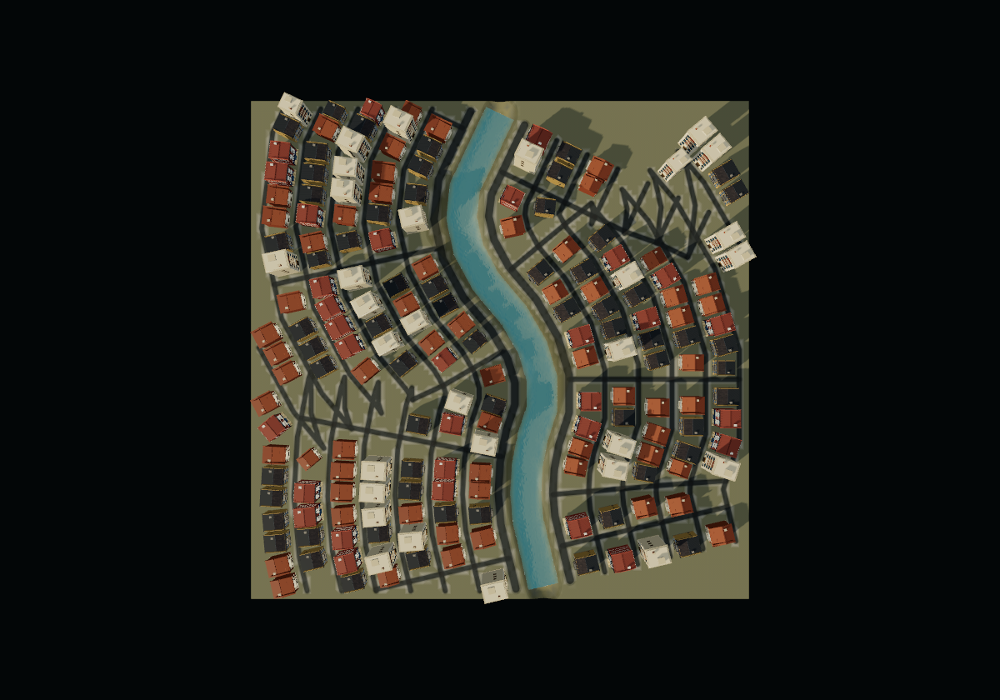

# 程序化城市：停止迭代时的问题记录

记录日期：2026-09-29。按用户要求停止继续开发，只提交已经完成的实现与实验工具。几何安全测试通过，**城市道路的视觉形态尚未验收**。

## 1. 远岸道路出现自交和尖锐折返（优先处理）

- 现象：弯河外侧出现 V/W 形锯齿、接近原路折返的道路；右上、左中最明显。
- 已确认原因：`src/shared/mapWaterfrontLayout.ts` 的 `offsetBank` 按河岸逐点做 miter 偏移。偏移距离超过局部弯道曲率半径时，偏移线会反向并自交。现有水域、地图边界、建筑净距和连通检查不会排除这种道路。
- 只读诊断：本例左岸第 4 排（偏移约 36.83m）出现约 167° 折返；右岸第 3 排（约 26.03m）已出现约 161° 折返，远排可接近 180°。未实施剪环、曲率放松或重建道路。
- 后续应补的验收：道路自身不形成意外自交回环；不能出现极短距离尖锐反向；道路交叉应有合理连接。结合顶视图及沿街视角检查，不能只看净距、户数或测试是否通过。

## 2. 扇形街区过于规则，缺少真实城市的路网层级

- 现象：多排道路等距沿河偏移，横路复用同一批河道站点，形成连续扇形分区。
- 已确认原因：整个岸带都沿用同一条河的方向场；外侧街道仍过强地追随河流曲率。
- 待研究方向：近岸保留顺岸道路，外侧逐渐转为适合自身地块的街网；错开支路交点，体现主路、街道、巷道及局部生长差异。不是简单给建筑或路点增加随机抖动。此方案尚未实现。

## 3. 密度改善不能作为规划质量验收

此前地图只开发距岸 38m、最多三排的狭窄带状区域，导致外侧大片可用地留空。现已扩展街区行数和按面积分配的区块预算，受控示例从 107 栋增至 185 栋，两侧外缘有实际建筑。但扩展也放大了问题 1、2；不能把这版称为最终完成的城市。

最新地图实际建筑包围轮廓的并集约 7,814m²，占整张 25,600m² 地图约 30.5%，占扣除水域的土地约 32.6%。该口径包含建筑轮廓内的庭院；不是实心建筑面积。实际旋转碰撞盒审计未发现建筑互撞、占路或占水。每一岸内部连通，当前受控例没有桥，两岸之间不连通。

## 4. 提示词测试与受控规划必须分开报告

- “上海”“庞贝城”已经走过 GPT 规划、DeepSeek 资产生成及事务保存路径；其原始模型代码和诊断保存在本地实验输出中。
- 最新弯河示例是保持河道、地图尺寸、种子及资产不变的受控规划，不代表任意模糊提示词都能生成同等效果。
- 先前拿直河旧图展示材质对比，容易让用户误以为弯河布局被替换。后续比较应固定地图、镜头和资产，并明确标注改变的变量。
- 灰盒中的树也可能显示为方块，不能据灰盒方块总数推断房屋数量。

## 5. 诊断与实际保存结果存在差异

`spatialPolicy:'diagnose'` 下，外层不采用自动修复，但内部 lint 仍可能按假设修复逐步检查。旋转建筑的世界 AABB 误报重叠后，假设移动可能继续触发 spawn 警告。某些诊断文案会写“已移动”，同时 `repaired:false`；保存地图实际未移动。此轮没有修改全局 lint。继续工作时，应区分实际旋转碰撞盒审计与假设修复产生的警告。

## 复现与证据

- 工作分支：`codex/procedural-cities`；未推送远端。
- 当前完整城区：`map-8e903b9d-c986-4b18`；此前窄岸带：`map-b141c841-6690-4ed1`。本地运行时数据不入 Git。
- 核心参数：地图 `[160,32,160]`、seed `901`、河道点 `[[0,-76],[-18,-38],[18,5],[6,42],[14,76]]`、河宽 `10`、平滑度 `0.82`、bankDepth `80`、waterSetback `2`、roadWidth `2.2`、arterialWidth `3.5`、blockSize `38`、parcelWidth `6`、parcelDepth `8`、setback `0.3`。
- 可移植的几何复现用例：`tests/mapWaterfrontLayout.test.ts` 中 `fills the outer land of a wide bank band with connected streets and safe edge setbacks`。现有断言验证边界/净距/连通/预算，**没有**验证自交与折返。
- 本地完整回放输入：`output/urban-city-study/river-bend-full-input.json`。已有资产时运行 `npm.cmd exec tsx -- scripts/replayUrbanPrompt.ts output/urban-city-study/river-bend-full-input.json river-bend-replay --save`，会新建地图，不覆盖旧图。输入及资产为本机实验记录。
- 原始提示词工具：`scripts/testUrbanPrompt.mjs`；视觉采集工具：`scripts/captureUrbanCityStudy.ts`；材质测试工具：`scripts/testUrbanRoadStyle.ts`。实际模型调用可能付费，回放已有规划与资产无需再次调用模型。
- 全量验证：1,102/1,102 测试通过，生产构建通过；编辑器及原生查看器已加载。没有将这些结果等同于视觉验收。

下面保存的是存在上述道路问题的版本，用于下一轮复现，**不是通过验收的效果图**。

